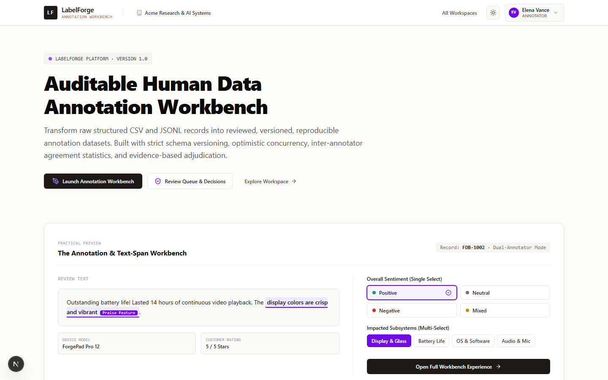
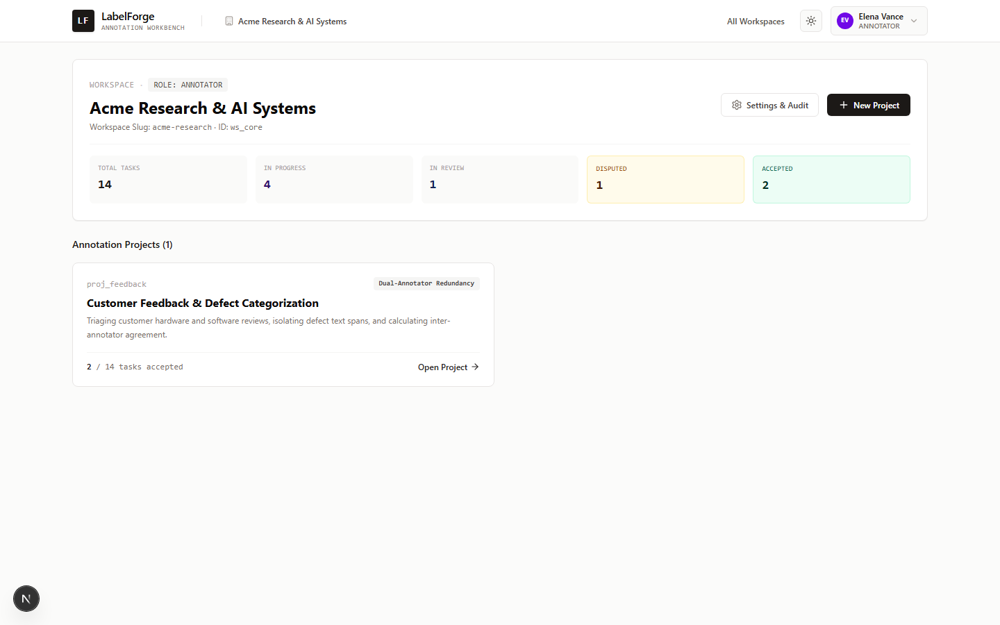
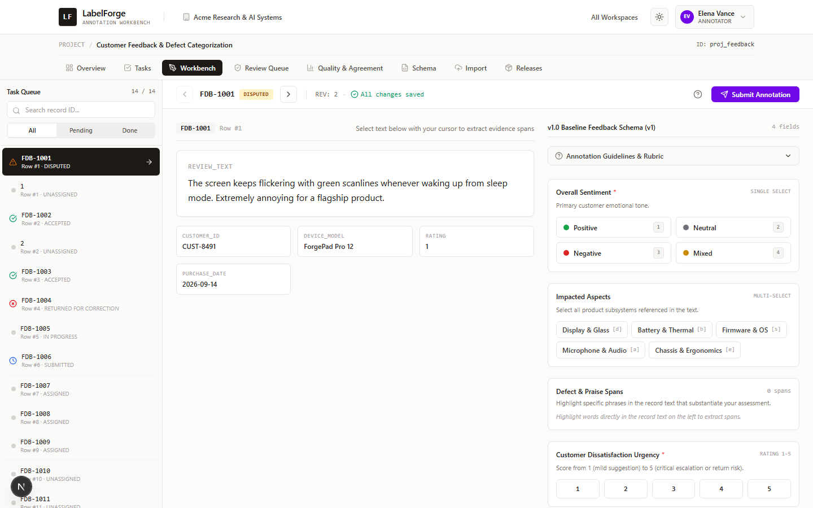
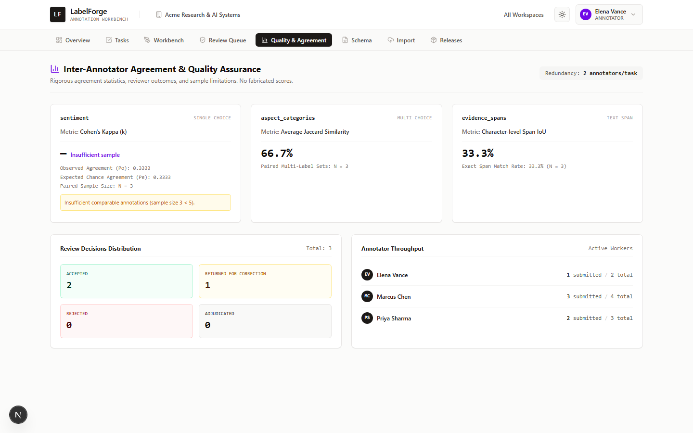

# LabelForge

Auditable human-in-the-loop data annotation workbench for teams that need
trustworthy labeled datasets: versioned schemas, optimistic concurrency,
inter-annotator agreement metrics, dispute adjudication, and SHA-256 verified
releases.

[](https://labelforge-iota.vercel.app)
[](https://github.com/devtechedge/labelforge_g3.8/actions)
[](https://nextjs.org)
[](https://www.typescriptlang.org/)
[](LICENSE)

## Live Demo

The hosted demo is deployed to Vercel:
**https://labelforge-iota.vercel.app**

> Demo mode uses an ephemeral database that is re-seeded on every cold start.
> Because the deployment runs on serverless instances, changes you make (new
> workspaces, annotations, imports, releases) may not persist between visits.
> Run locally for a persistent, fully writable copy of the same app.

The demo ships with a pre-configured workspace (Acme Research & AI Systems)
and four personas you can switch between from the header: an owner/manager,
two annotators, and a reviewer/adjudicator. This makes it easy to walk the
whole workflow without creating accounts.

## What it does

- **Versioned schemas** - schema changes create new pinned versions; tasks and
  completed annotations stay tied to the schema they were answered under.
- **Optimistic concurrency** - revision numbers catch stale overwrites; a
  conflict opens a side-by-side reconciliation dialog (HTTP 409).
- **Agreement metrics** - Cohen's kappa for single-choice labels, multi-label
  Jaccard, and character-level span IoU, with transparent warnings when
  sample sizes are too small.
- **Review and adjudication** - reviewers pass, return, or reject submissions;
  disputes move to an adjudication workbench where ground truth is resolved
  with mandatory rationale.
- **RFC 4180 import quarantine** - malformed CSV/JSONL rows are reported with
  exact row numbers and error codes and are never committed.
- **Reproducible releases** - canonical JSONL and formula-safe CSV exports
  with SHA-256 manifests that record author, schema, and record counts.
- **Audit trail** - every state-changing action is recorded per workspace.

## Stack

| Layer | Technology |
| ----- | ---------- |
| Framework | Next.js 15 (App Router) |
| Language | TypeScript (strict) |
| UI | React 19, Tailwind CSS 4, lucide-react |
| Storage | SQLite via Node.js built-in `node:sqlite` |
| Tests | Node built-in test runner |
| Deployment | Vercel (serverless) |

## Quick start

Requirements: Node.js 22.13 or newer (SQLite built-in module).

```bash
npm install
npm run dev
```

Open http://localhost:3000. The app seeds demo data on first run and stores
it in `data/labelforge.db` so your local changes persist.

### Scripts

| Command | Purpose |
| ------- | ------- |
| `npm run dev` | Start the development server |
| `npm run build` | Production build |
| `npm run start` | Run the production build |
| `npm run lint` | ESLint |
| `npm run typecheck` | TypeScript type checking |
| `npm test` | Run the domain test suite |
| `npm run test:e2e` | Run Playwright smoke tests (local: `npx playwright install chromium` first) |

## Project structure

```
app/                  App Router pages and API routes
components/           React components (header, workbench, modals)
hooks/                Shared hooks
lib/domain/           Pure domain logic: importers, agreement, concurrency, export
lib/db/               SQLite schema, demo seed, adapter
lib/auth/             Demo personas and session helpers
tests/                Node test suite
```

The domain layer is kept free of React and I/O so the core rules (transition
matrix, kappa, canonical serialization) are unit-testable in isolation.

## API

All routes live under `/api` and return JSON (`{ error }` shape on failure).
Primary surfaces: `workspaces`, `projects`, `tasks`, `annotations`, `releases`,
`imports`, `invitations`, `audit`, `auth/current`.

## Screenshots






## Deployment

The demo runs on Vercel with a git-connected project. See
[DEPLOYMENT.md](DEPLOYMENT.md) for the hosting wiring, the ephemeral demo
database behavior, and verification steps.

## Try the workflow

Open the [live demo](https://labelforge-iota.vercel.app), switch personas from
the top-right corner, and walk the full loop: annotate a task, submit it,
review a submission, open a dispute, adjudicate it, and publish a release with
its SHA-256 manifest. The light/dark theme toggle also lives in the header.

## Security

See [SECURITY.md](SECURITY.md) for the threat model, demo-mode residual risks,
and production hardening recommendations.

## License

MIT. See [LICENSE](LICENSE).
